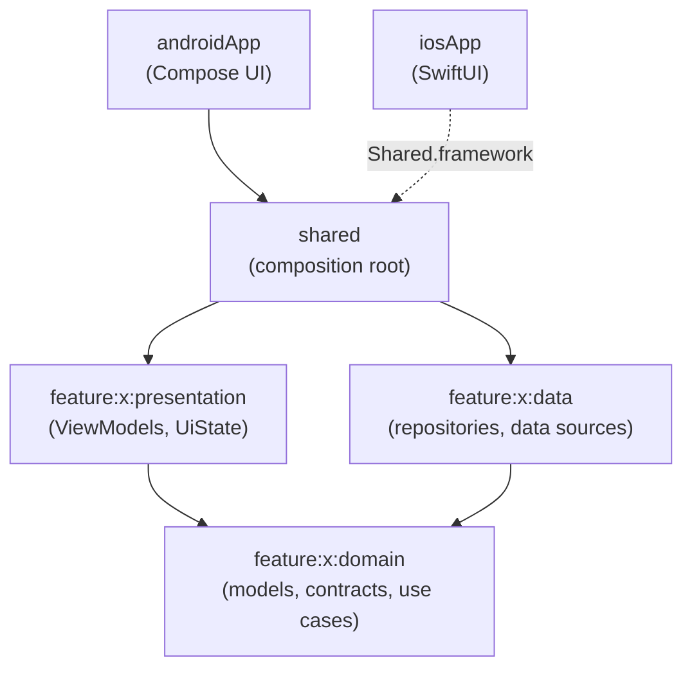

# Architecture

## Principles

1. **Native UI, shared logic.** Each platform renders with its own toolkit (Compose / SwiftUI) and
   design language (Material 3 / Human Interface Guidelines). Everything below the UI is shared Kotlin.
2. **Clean architecture per feature.** Every feature is split into `domain`, `data` and
   `presentation` Gradle modules. Module boundaries make wrong dependencies impossible to compile;
   [Konsist tests](../konsist/src/test/kotlin) catch the rest (naming, placement, immutability).
3. **Unidirectional data flow.** ViewModels expose one immutable `UiState` through a `StateFlow`; UIs
   render it and send user intents back as plain function calls (`onRefresh()`).
4. **Test what matters, fast.** Domain, data and presentation are tested in `commonTest`, running on
   the JVM (seconds) and on the iOS simulator (CI). Fakes over mocks.

## Module graph



| Module | Contains | May depend on | Must not depend on |
|---|---|---|---|
| `feature:x:domain` | models, repository **interfaces**, use cases | coroutines | Android, iOS, Koin, Ktor, data, presentation |
| `feature:x:data` | repository implementations (`internal`), data sources, `expect`/`actual`, Koin module | its domain, Koin | presentation, other features |
| `feature:x:presentation` | `ViewModel`s, `UiState`, Koin module (use cases + ViewModels) | its domain, AndroidX ViewModel, Koin | data, other features |
| `shared` | `appModules` list, `initKoin`, iOS entry points (`AppInitializer`, `ViewModels`) | everything above | — |
| `androidApp` | Compose screens, theme, navigation, `Application` | `shared` | data classes directly |
| `iosApp` | SwiftUI views, assets, `SharedViewModel` helper | `Shared` framework | — |

Features never depend on each other. If two features need the same thing, move it into a
`core:<name>` module (for example `core:network`, `core:database`, `core:designsystem`).

## Data flow (home feature)

```
User taps "Refresh"
  → HomeScreen (Compose) / HomeContent (SwiftUI) calls onRefresh()
  → HomeViewModel.onRefresh()  — sets isLoading, launches in viewModelScope
  → GetGreetingUseCase()       — business rules (normalizes the platform name)
  → GreetingRepository         — domain interface
  → DefaultGreetingRepository  — data impl, switches to Dispatchers.IO
  → PlatformInfoDataSource     — expect/actual: android.os.Build / UIKit.UIDevice
  ← HomeUiState(isLoading=false, platformName="Android 16")
  ← StateFlow → collectAsStateWithLifecycle() (Android) / for await (iOS, via SKIE)
```

User-facing text lives in the UI layer (`strings.xml` / `Localizable.xcstrings`), never in shared
code, so each platform localizes natively.

## Dependency injection (Koin)

- Each `data` module exposes `<feature>DataModule`, each `presentation` module exposes
  `<feature>PresentationModule` (use cases + ViewModels), always in a `di` package.
- `shared/AppModules.kt` lists them all in `appModules`; `initKoin()` starts Koin once per app launch.
- Android gets ViewModels with `koinViewModel()`, scoped to the Navigation 3 back-stack entry.
- iOS gets them through `ViewModels.shared.<name>(owner:)` wrapped in `SharedViewModel`.
- `AppModulesTest` (all platforms) and `AppModulesVerifyTest` (JVM, `Module.verify()`) fail the
  build when a binding is missing.

## How iOS consumes Kotlin

- `:shared` is packaged as a **static framework named `Shared`**. Only modules listed with
  `export(...)` in `shared/build.gradle.kts` keep clean names in Swift; export every
  `presentation` module.
- **SKIE** improves the generated Swift API: `StateFlow` → `AsyncSequence`, sealed classes →
  Swift enums (`onEnum(of:)`), `suspend` functions → `async`.
- ViewModel lifecycle: `SharedViewModel` (Swift) owns an `IosViewModelStoreOwner` (Kotlin) and
  clears it on `deinit`, cancelling `viewModelScope` exactly like Android does when a screen leaves.
- The Xcode build phase runs `./gradlew :shared:embedAndSignAppleFrameworkForXcode`.
- The Xcode project uses **synchronized folders**: any file added under `iosApp/iosApp/` is part of
  the app automatically, so there are no `project.pbxproj` edits.

## Adding a feature

Claude Code users can run the `new-feature` skill (`.claude/skills/new-feature`). Manually:

1. Create `feature/<name>/{domain,data,presentation}/build.gradle.kts` using the
   `template.feature.domain|data|presentation` plugins (copy `feature/home`).
2. `include(...)` the three modules in `settings.gradle.kts`.
3. Domain: model(s), `<Name>Repository` interface in `domain.repository`, use cases in
   `domain.usecase` (one public `operator fun invoke`).
4. Data: `internal class Default<Name>Repository` in `data.repository`, data sources in
   `data.datasource`, `val <name>DataModule` in `data.di`.
5. Presentation: `<Name>UiState` (data class, `val`s only) + `<Name>ViewModel` in `presentation`,
   `val <name>PresentationModule` in `presentation.di`.
6. Shared: add both Koin modules to `appModules`, add `api(...)`/`implementation(...)` deps and
   `export(projects.feature.<name>.presentation)`, add a `ViewModels.<name>(owner)` accessor.
7. Android: `androidApp/.../feature/<name>/<Name>Screen.kt` (Route + stateless Screen + previews),
   add a `Route.<Name>` key and an `entry<Route.<Name>>` in `AppNavigation`.
8. iOS: `iosApp/iosApp/Features/<Name>/<Name>View.swift` (stateful View + stateless Content + previews).
9. Tests: `<UseCase>Test`, `Default<Name>RepositoryTest`, `<Name>ViewModelTest` (Konsist requires
   a test for every use case and ViewModel).
10. `./gradlew check`.

## Recipes not shown in the skeleton

Networking (Ktor), persistence (Room KMP), key-value settings, and passing arguments between screens
are documented as ready-to-apply rules in [`.claude/rules/`](../.claude/rules), so they stay
consistent with this architecture when you add them.
